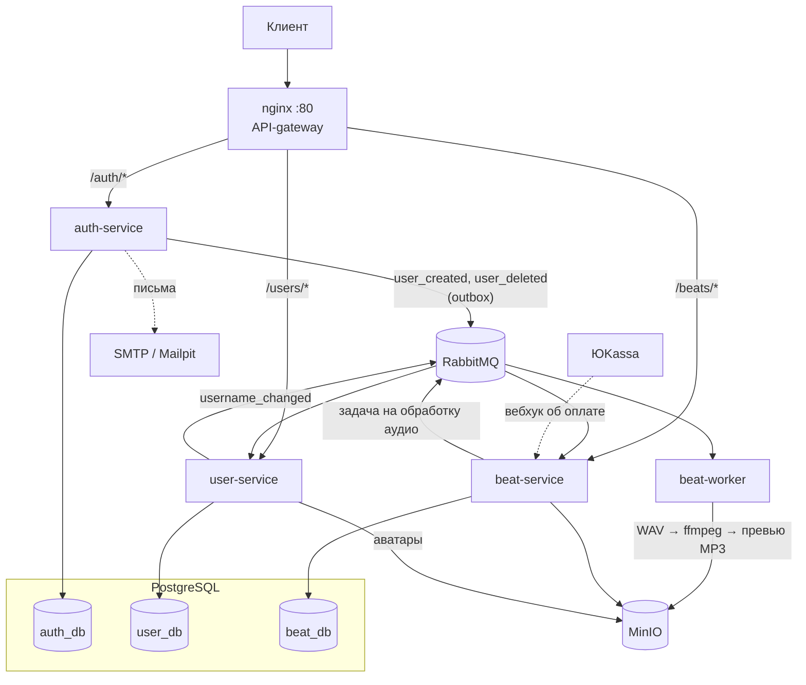

# Wave — маркетплейс битов

Backend платформы, где музыкальные продюсеры продают биты, а артисты покупают на них лицензии.
Продюсер загружает WAV — сервис сам режет превью с голосовым тегом-водяным знаком, конвертирует в MP3
и публикует бит в каталоге. Покупатель слушает превью, оплачивает через ЮKassa и получает
доступ к полному WAV и стемам.

Проект запущен в закрытой бете; в этом репозитории — backend (веб-клиент на React живёт отдельно). Архитектура — три микросервиса на FastAPI, общающихся через JWT и
события RabbitMQ; у каждого сервиса своя база PostgreSQL.

## Стек

| Слой | Технологии |
|---|---|
| Язык и фреймворк | Python 3.12, FastAPI, Pydantic v2, pydantic-settings |
| Данные | PostgreSQL 17, SQLAlchemy 2.0 (async, asyncpg), Alembic |
| Межсервисное взаимодействие | RabbitMQ (aio-pika), transactional outbox |
| Файлы | S3-совместимое хранилище MinIO (aioboto3), ffmpeg |
| Платежи | ЮKassa (вебхук + polling-фолбэк) |
| Авторизация | JWT (access + refresh), bcrypt |
| Инфраструктура | Docker Compose, nginx (API-gateway) |
| Наблюдаемость | Prometheus, Grafana, Loki, Promtail |
| Качество кода | pytest, ruff, mypy, pre-commit, gitleaks |

## Архитектура



| Сервис | Отвечает за |
|---|---|
| **auth-service** | Регистрация, вход, refresh-токены, подтверждение email, смена пароля, удаление аккаунта. Публикует события через transactional outbox |
| **user-service** | Профили, аватары, подписки (follow). Создаёт/удаляет профиль по событиям от auth |
| **beat-service** | Каталог и поиск битов, загрузка, лайки, прослушивания, покупки и платежи ЮKassa, выдача файлов купившим |
| **beat-worker** | Фоновая обработка аудио из очереди: превью с войс-тегом, MP3, загрузка в S3 |
| **nginx** | Единая точка входа: маршрутизация по префиксу на нужный сервис |

Сервисы не ходят друг к другу по HTTP: данные пользователя берутся из JWT, а изменения
распространяются событиями через RabbitMQ. Подробнее, с диаграммами покупки и выдачи файлов —
в [docs/architecture.md](docs/architecture.md).

## Запуск

Нужен только Docker (с Compose v2).

```bash
git clone https://github.com/<your-account>/wave.git
cd wave
docker compose up --build
```

Файл `.env` для запуска не нужен: у всех переменных в `docker-compose.yml` есть dev-значения.
Чтобы их переопределить, скопируйте [`.env.example`](.env.example) в `.env`.
Первая сборка занимает несколько минут.

| Что | Адрес |
|---|---|
| API-gateway | http://localhost |
| Swagger: auth / users / beats | http://localhost/auth/docs · http://localhost/users/docs · http://localhost/beats/docs |
| Mailpit (письма подтверждения email) | http://localhost:8025 |
| RabbitMQ (wave / wave) | http://localhost:15672 |
| MinIO-консоль (wave-minio / wave-minio-secret) | http://localhost:9001 |
| PostgreSQL (wave / wave) | `localhost:5432`, базы `auth_db`, `user_db`, `beat_db` |

Миграции Alembic применяются автоматически при старте каждого сервиса.

Мониторинг (Prometheus, Grafana, Loki) запускается отдельным профилем:

```bash
docker compose --profile monitoring up --build
```

Grafana будет на http://localhost:4000 (admin / admin) с готовым дашбордом.

> Оплата по умолчанию выключена. Чтобы проверить покупку, укажите тестовые
> `YOOKASSA_SHOP_ID` и `YOOKASSA_SECRET_KEY` из [личного кабинета ЮKassa](https://yookassa.ru/developers) в `.env`.

## Разработка

У каждого сервиса свой `pyproject.toml` и lock-файл (Poetry):

```bash
cd backend/beat
poetry install --with test
poetry run pytest          # юнит-тесты
poetry run mypy app config.py worker.py
```

Линтер, форматтер и проверки типов подключены через pre-commit:

```bash
pip install pre-commit
pre-commit install          # проверки перед каждым коммитом
pre-commit run --all-files  # прогнать всё вручную
```

В хуках: ruff (lint + format), mypy отдельно для каждого сервиса, gitleaks (поиск секретов),
базовые проверки YAML/TOML и пробелов.

## Структура репозитория

```
backend/
  auth/  user/  beat/        # сервисы: app/, migrations/, tests/, Dockerfile
  nginx/nginx.conf           # маршрутизация API-gateway
deploy/postgres/             # создание баз при первом старте Postgres
deploy/vps-cloudflared/      # конфиг Cloudflare Tunnel для прод-релея
docs/                        # архитектура и roadmap
monitoring/                  # конфиги Prometheus, Loki, Promtail, дашборд Grafana
docker-compose.yml
```

## Инженерные решения

<!-- Заполнить: ключевые решения, альтернативы и компромиссы. -->
