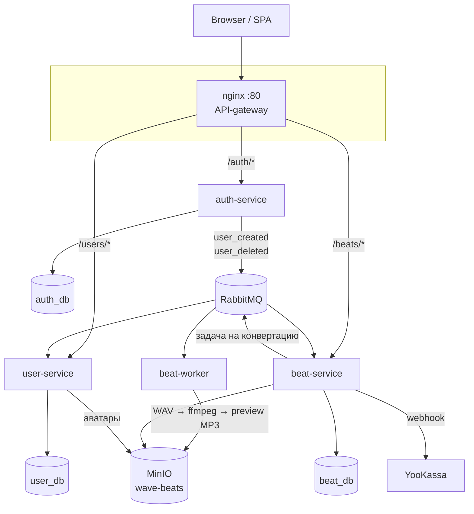
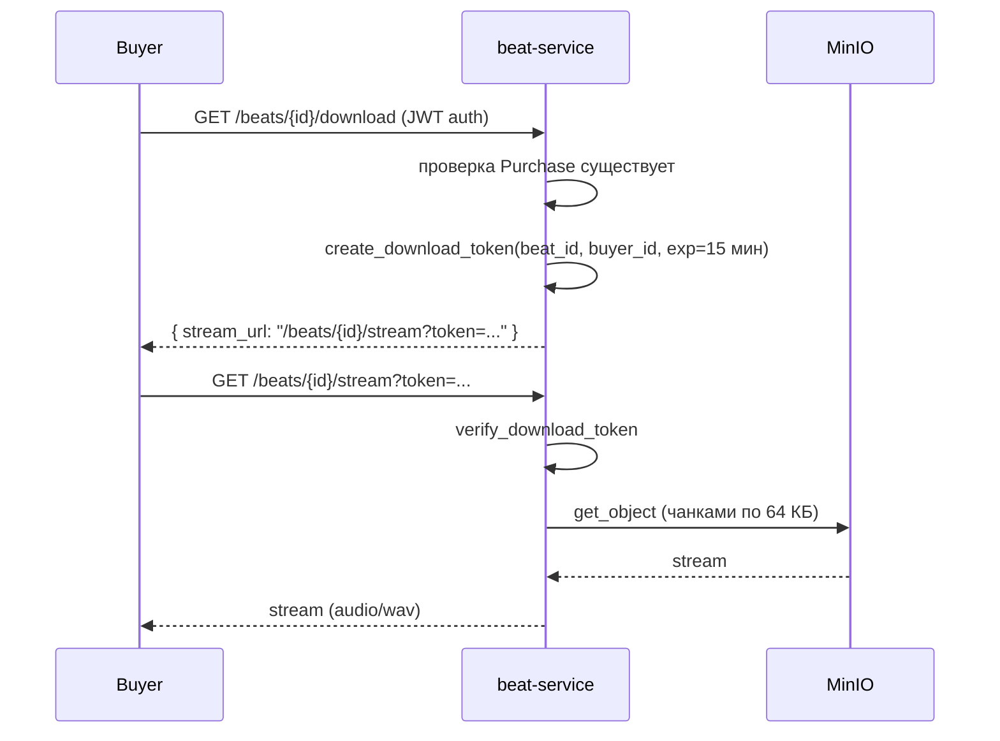
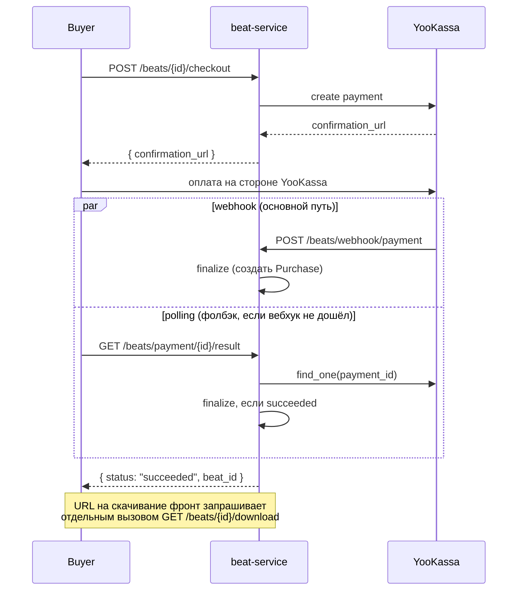
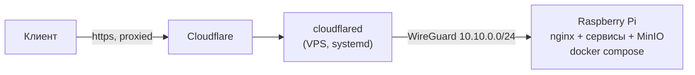

# Архитектура Wave

Этот документ описывает, как устроены сервисы, как они разворачиваются в проде и почему
приняты ключевые технические решения. Для быстрого старта локально см. [README](../README.md),
для текущего прогресса и плана — [roadmap.md](roadmap.md).

## Сервисы

Три независимых FastAPI-сервиса за общим nginx-гейтвеем, у каждого своя база PostgreSQL
(database-per-service; локально — три базы в одном контейнере Postgres). Связь
между сервисами — либо через JWT (без лишних HTTP-вызовов), либо асинхронно через RabbitMQ.

**Почему JWT, а не HTTP между сервисами.** `username` и `sub` зашиты в JWT при логине —
beat-service и user-service читают их из токена и не дёргают auth-service синхронно на
каждый запрос. Дешевле и не создаёт цепочку отказов между сервисами.

**Почему RabbitMQ, а не прямые вызовы для событий.** `user_created` → user-service создаёт
профиль, `user_deleted` → он же чистит данные, `username_changed` → beat-service
синхронизирует `author_name` в уже загруженных битах. Событийная связь не блокирует
регистрацию, если user-service временно недоступен.

## Хранение файлов и приватность контента

MinIO — общий бакет `wave-beats`, но доступ к разным типам файлов различается:

| Контент | Доступ | Почему |
|---|---|---|
| Обложка, превью MP3 | Публичный стабильный URL, `Cache-Control` | Не секретный контент — кэшируется браузером и Cloudflare edge |
| Полный WAV, стемы | JWT-стрим через beat-service, MinIO закрыт | Платный контент — доступ только купившим |
| Аватар | Presigned URL | Публичный, но не так чувствителен к кэшу как обложки в каталоге |

**Почему стрим с токеном, а не presigned S3 URL.** Presigned URL, отданный один раз, живёт
до истечения TTL независимо от того, что происходит с покупкой дальше — его нельзя отозвать
и нельзя ограничить по количеству использований без доп. состояния. JWT с коротким TTL (15
мин) проверяется на каждый запрос стрима, и весь платный трафик идёт через сервис — MinIO
для WAV/стемов вообще не открыт наружу.

## Покупка бита

Финализация (`PaymentService._finalize_succeeded`) идемпотентна: и вебхук, и опрос могут
попытаться создать `Purchase` одновременно — уникальный констрейнт в БД ловит гонку, второй
вызов просто логирует и откатывается, ошибку пользователь не видит.

## Прод-деплой (закрытая бета)

Бета крутится на собственном Raspberry Pi (домашний канал, не дата-центр), но напрямую
держать Cloudflare-туннель с Pi не получилось — а с 09.06.2025 в РФ операторы под ТСПУ режут
трафик к Cloudflare (TLS ECH) до ~16 КБ. Поэтому туннель вынесен на отдельный VPS, а до Pi
идёт через WireGuard:

- **VPS** — только релей, не хранит данных.
- **WireGuard**, а не SSH `-R` реверс-туннель — SSH port-forwarding давал TCP-over-TCP
  деградацию при переиспользовании соединения на нестабильном домашнем канале.
- Для публичного запуска запланирован переход на Cloudflare только как DNS (grey cloud) +
  TLS напрямую на VPS через Let's Encrypt — уберёт throttling-специфичный fingerprint из
  трафика. Для закрытой беты (узкий круг по инвайтам) риск принят как временный.

## Известные ограничения (актуально на момент написания)

- Лицензия при покупке всегда `basic` (полный WAV) — пикер тиров Basic/Premium/Exclusive
  спроектирован, но не реализован; стемы отдаются только по `license_type="premium"`,
  который сейчас нигде не выставляется.
- Обложки и превью публичны и кэшируются (включая Cloudflare edge) без модерации при
  загрузке — риск принят для закрытой беты, план на будущее описан в
  [roadmap.md](roadmap.md#задача-9--модерация-обложек-подробности).
- Rate limiting в nginx не настроен — каталог и auth не защищены от скрейпинга/брутфорса.

Полный список задач и их статус — [roadmap.md](roadmap.md).
